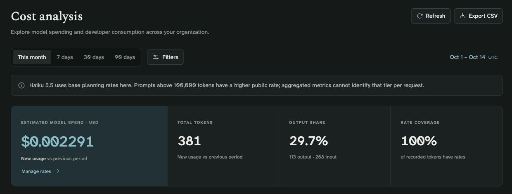
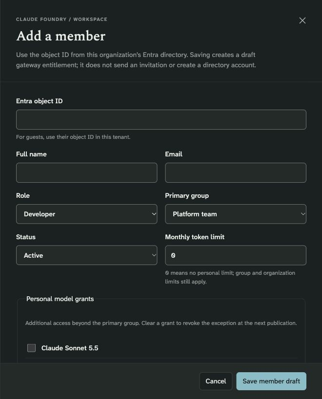
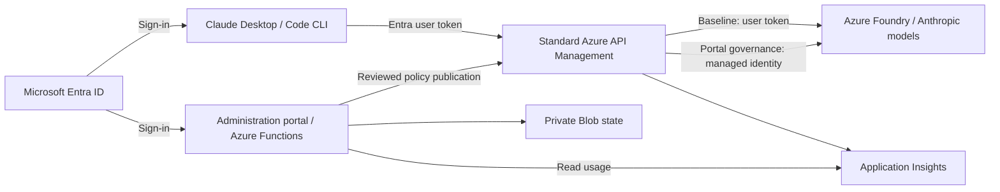

# Claude Foundry

**Claude Desktop Chat, Desktop Code, and the Claude Code CLI—connected to your organization's Azure Foundry models through standard Azure API Management.**

Give developers a familiar Claude experience with Microsoft Entra sign-in. Deploy the infrastructure in your Azure subscription, distribute a Mac installer, and manage access and usage through a customer-owned administration portal. No shared inference API key or separate AI Gateway resource is required.

[Install on a Mac](docs/macos.md) · [Deploy for your organization](docs/administrator.md) · [Explore the portal](docs/portal-guide.md) · [Contribute](CONTRIBUTING.md)

> **Portal preview:** the management portal is included in `main` for continued development and evaluation. Its Azure deployment guide uses an isolated preview API. See the [validation record and remaining production checks](portal/VALIDATION.md) before planning a customer rollout. Merging source does not deploy Azure resources.



*Captured from the running Azure-hosted preview on October 14, 2026. Real verification traffic; planning estimates, not an Azure invoice. [See the complete feature tour](docs/portal-guide.md).*

## What you can do

| For | Capabilities |
| --- | --- |
| **Developers** | Use Desktop Chat, Desktop Code, and the Code CLI with organization models. Sign in with Microsoft. Install without Azure CLI using an MSAL profile. Restore previous Claude settings when needed. |
| **Platform teams** | Deploy Foundry, standard APIM, and monitoring; discover eligible Anthropic models; publish a model catalog; build organization-specific Mac installation bundles. |
| **Portal administrators** | Register members, import CSVs, assign groups and model grants, review access requests, and publish token quotas and rate limits to a dedicated gateway API. |
| **Finance and operations** | Explore usage by model, group, and developer; combine filters; compare periods; export CSVs; maintain sourced planning rates and dollar thresholds. |
| **Security reviewers** | Inspect Entra authentication, API-enforced roles, managed identities, private portal storage, policy publication, and administrative audit records. |

The portal manages gateway access and operational metadata. Entra remains responsible for directory accounts and sign-in policy; Azure Cost Management remains responsible for billed spend. Conversations are not displayed or managed in the portal.

## Choose your starting point

### I want to use Claude on my Mac

Ask your organization for its installation ZIP. You do **not** need an Azure subscription, Git checkout, or infrastructure deployment permissions.

1. Install your organization's approved Claude Desktop and, if needed, Claude Code CLI.
2. Extract the organization ZIP and open `Install.command`.
3. Complete Microsoft sign-in, then fully quit and reopen Claude Desktop.
4. Select the organization profile and a published model. Send a small test message.

The installer supplies its own isolated runtime and preserves unrelated settings. An MSAL profile requires no Azure CLI. Existing consumer Claude history stays in its original profile and does not migrate automatically.

**[Mac installation, verification, and restore →](docs/macos.md)**

### I want to deploy this for my organization

An Azure administrator deploys the shared foundation once. An Entra administrator may also be needed for app registration and consent. Start with a small pilot and your own reviewed configuration.

```bash
git clone https://github.com/orsharon7/claude-foundry.git
cd claude-foundry
uv sync --frozen --extra auth
mkdir -p .local
cp infra/parameters.example.json .local/parameters.json
```

Edit the placeholders before deploying. The [administrator guide](docs/administrator.md) covers the complete sequence:

1. Confirm subscription eligibility, regions, permissions, and Marketplace details.
2. Deploy new infrastructure, or configure a dedicated API on existing APIM/Foundry resources.
3. Discover eligible models, review paid terms, deploy, and verify inference.
4. Publish **Claude via Azure Foundry** in APIM and connect observability.
5. Choose Azure CLI or MSAL sign-in, export a client profile, and build the Mac ZIP.
6. Optionally deploy the [isolated management portal preview](portal/README.md#isolated-azure-preview).

Model availability and quota depend on the subscription, region, and deployment type. Catalog discovery is not a guarantee that a model can be purchased or invoked.

**[Organization deployment guide →](docs/administrator.md)**

### I want to evaluate the management portal

Start with the [visual walkthrough](docs/portal-guide.md), then follow the [Azure preview deployment guide](portal/README.md). The portal is a single-tenant application hosted in your subscription. There is no shared hosted service to sign up for.



*Access changes are saved as drafts. An owner or administrator reviews and publishes them before gateway enforcement changes.*

## How it fits together



These are two gateway authorization modes, not two requests for every inference call:

| Mode | Where inference access is decided | When to use |
| --- | --- | --- |
| **Baseline gateway** | APIM validates the user token; Foundry applies the user's inference RBAC. One published model allowlist applies to callers. | Establish the gateway and Mac onboarding without the portal. |
| **Portal governance preview** | APIM validates the user token and enforces published membership, model grants, and token limits. APIM's managed identity calls Foundry. | Evaluate per-developer/group administration on a separate preview API. |

The portal is outside the inference path: its availability does not determine whether an already-published gateway policy can serve requests. Users with direct Foundry RBAC can bypass gateway controls; review that access when adopting portal governance. Read the [security model](docs/security.md) for the full boundaries.

## Costs and practical limits

- **Azure charges apply.** APIM has an ongoing service charge; inference and monitoring are metered. The portal uses Functions Flex Consumption with no always-ready instances, but storage, private endpoints, DNS, and logs can still incur charges.
- **Dollar budgets are planning thresholds.** They do not stop Azure billing. Token quotas and request limits apply after policy publication; streaming estimates and concurrent requests can overshoot.
- **Cost analysis is an estimate.** Rates are maintained by administrators. Cache pricing, some prompt-length tiers, discounts, tax, and infrastructure costs are not reconciled. See the [pricing reference](portal/PRICING.md).
- **Scale must be measured.** A 2,000-member import/policy-size check has passed; 2,000 concurrent developers have not been load-tested.
- **Current onboarding targets macOS and Azure public cloud.** The baseline inference endpoints are public HTTPS. Private portal storage does not make Foundry or APIM private. Windows/Linux installers, SCIM, MDM enrollment, conversation migration, and immutable compliance archives are not included.

## Documentation

| Task | Guide |
| --- | --- |
| Deploy infrastructure, models, and the gateway | [Organization administrator](docs/administrator.md) |
| Install, sign in, update, or restore Claude settings | [Mac installation](docs/macos.md) |
| Learn every portal workspace with real screenshots | [Portal guide and gallery](docs/portal-guide.md) |
| Deploy or develop the portal | [Portal engineering guide](portal/README.md) |
| Operate, upgrade, recover, and plan a rollout | [Operations guide](docs/operations.md) |
| Query requests, errors, and token metrics | [Observability](docs/observability.md) |
| Review identities, data, and trust boundaries | [Security architecture](docs/security.md) |
| Understand sign-in, roles, Azure RBAC, and publication | [Identity and permissions](docs/identity-and-permissions.md) |
| Diagnose errors | [Troubleshooting](docs/troubleshooting.md) |
| Understand scope and common questions | [FAQ](docs/faq.md) |
| Make a code or documentation contribution | [Contributing](CONTRIBUTING.md) |

## Support and contribution

For installation and access problems, contact your organization's platform team first. For reproducible project defects or feature proposals, [open an issue](https://github.com/orsharon7/claude-foundry/issues/new/choose) with sanitized details. Use the [security reporting guidance](SECURITY.md) for vulnerabilities.

Contributions are welcome through focused pull requests. [CONTRIBUTING.md](CONTRIBUTING.md) covers local setup, validation, architecture, documentation, and the review process. CI validates changes; it does not deploy them.

**Project and licensing status:** this repository is independently maintained and does not provide Microsoft or Anthropic product support or certification. No open-source license has been selected yet; public visibility alone is not a redistribution license. Confirm the project's licensing terms before redistributing it to customers. Azure and Anthropic service terms apply separately.
