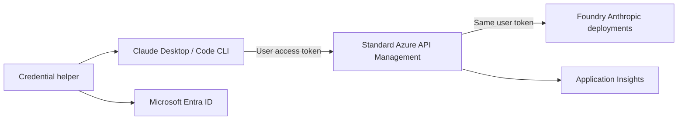

# Claude on Azure Foundry through API Management

> **Development branch:** `feat/admin-portal` contains an unreleased [management portal preview](portal/README.md). It is isolated from the released gateway/client setup. Do not deploy it to a production inference API or distribute a customer release until the portal’s release checks are complete.

Configure Claude Desktop **Chat and Code**, plus the Claude Code CLI, to use an organization's Anthropic deployments in Microsoft Foundry through standard Azure API Management.

Users sign in with Microsoft Entra ID. APIM validates their token and forwards it to Foundry, where Azure RBAC authorizes inference. No shared API key or new AI Gateway resource is required.



## Start here

| Audience | Guide |
| --- | --- |
| Organization administrator | [Deploy infrastructure, models and gateway](docs/administrator.md) |
| Mac user or desktop support | [Install, sign in and restore settings](docs/macos.md) |
| Platform operations | [Logs and metrics](docs/observability.md) |
| Security reviewer | [Authentication and trust boundaries](docs/security.md) |
| Troubleshooting | [Known errors and recovery](docs/troubleshooting.md) |

Administrators deploy infrastructure once, discover the models their subscription can actually provision, then export a small client profile. Users receive an installation bundle and complete Microsoft sign-in in their browser. The installer preserves unrelated Claude settings and creates recovery snapshots.

## Authentication options

| Mode | User installation | Organization prerequisite |
| --- | --- | --- |
| Azure CLI | Reuse an installed CLI, or install the official CLI without extensions | Foundry inference RBAC |
| MSAL | Isolated Python runtime and authentication libraries; no Azure CLI | Single-tenant public client app, delegated Cognitive Services permission/consent, Foundry inference RBAC |

The MSAL mode stores its token cache in macOS Keychain. Both modes acquire short-lived Cognitive Services access tokens. Background helpers never launch a sign-in prompt; users run the login command when interaction is required.

## Repository layout

- `infra/`: Bicep for Foundry, standard APIM v2, inference RBAC and monitoring.
- `src/claude_foundry/`: administrator commands, gateway policies, authentication and client configuration.
- `scripts/`: Mac bootstrap, client bundle creation and optional Entra app registration.
- `examples/`: placeholder configuration only.
- `tests/`: offline security, deployment and settings recovery checks.
- `.local/`: ignored organization configuration, deployment reports and verification evidence.

## Development

Use Python 3.11 or newer and [uv](https://docs.astral.sh/uv/). Azure CLI is required for administrator commands; it is optional on user machines.

```bash
uv sync --frozen --extra auth
uv run --frozen --extra auth pytest -q
uv run --frozen --extra auth ruff check src scripts tests
uv run --frozen --extra auth ruff format --check src scripts tests
az bicep build --file infra/main.bicep --outfile /tmp/claude-foundry.arm.json
```

`uv.lock` and `requirements-auth.lock` pin the tested Python dependencies. The Mac installer verifies dependency hashes. To refresh the installer lock after a reviewed dependency update:

```bash
uv export --frozen --extra auth --no-dev --no-emit-project --output-file requirements-auth.lock
```

Live checks make small billable requests. They validate authentication failures, the model catalog, inference, streaming, token counting and rejection of unknown models:

```bash
uv run --extra auth claude-foundry verify --config .local/client.json --all-models
```

## Scope and current limits

This release targets Azure public cloud and macOS user onboarding. New infrastructure uses public HTTPS endpoints and Basic v2 or Standard v2 APIM. Existing gateways can be reused. Anthropic token metrics require an APIM v2 tier.

Claude Desktop's third-party deployment has a separate local profile and conversation store. Existing consumer Claude history does not migrate automatically. Windows/Linux onboarding, private networking, organization budget enforcement and the future management web interface are outside this release. No management website is included.

The Azure CLI path has been exercised with native Desktop Chat, Desktop Code and CLI inference, including Opus 5.5 at Max effort. Customer bundle installation, browser sign-in, settings rollback and reinstallation have been tested on macOS. The Bicep foundation has been deployed into a new resource group with Basic v2 APIM, Foundry, inference RBAC and Application Insights. Both Global Standard and Data Zone Standard model deployment have been exercised, with requests, inference traces and per-model token metrics verified in Application Insights. The MSAL path has offline tests; validate tenant consent, Conditional Access and interactive sign-in in the target organization before a broad rollout.

See the [official Foundry Claude Code guide](https://learn.microsoft.com/en-us/azure/foundry/foundry-models/how-to/configure-claude-code), [Anthropic Desktop configuration reference](https://claude.com/docs/third-party/claude-desktop/configuration), and [APIM token metric policy](https://learn.microsoft.com/en-us/azure/api-management/llm-emit-token-metric-policy).
