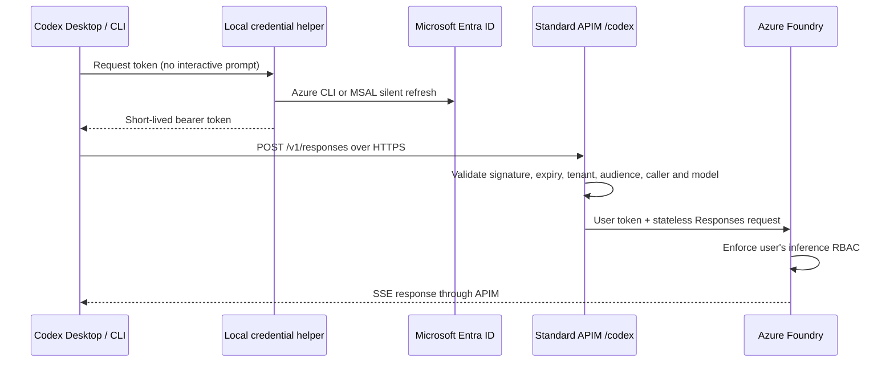

# Codex Desktop and CLI on Azure

Connect local Codex work to OpenAI models deployed in your organization's Azure Foundry resource, through a dedicated API on **standard Azure API Management**. Users authenticate with Microsoft Entra ID. Claude can use the same foundation through its separate API.

**Feature preview:** this work lives on `feat/codex-azure`. Review and pilot it before a customer rollout. The existing administration portal currently governs Claude; it does **not** publish Codex access policies, budgets, or OpenAI pricing. Codex uses the baseline Entra/RBAC gateway described below.

## What is supported

| Capability | Scope |
| --- | --- |
| Codex CLI | Local coding, streaming responses, shell tools, and subsequent turns through Azure |
| Codex Desktop | The same user configuration and command-backed credentials; the bundled engine has been tested. Visual app verification is a separate pilot check. |
| Model discovery | Eligible OpenAI **text Responses** models in the selected Foundry region, with available metered quota |
| Sign-in | Azure CLI tokens, or the existing MSAL browser sign-in flow without installing Azure CLI |
| Existing local conversations | Settings installation preserves history. Azure-backed conversations can resume. OpenAI-backed history may require the readable-text handoff below. |
| Monitoring | API-scoped Application Insights requests, dependencies, identity/model traces and token metrics |

Image generation, embeddings, speech, realtime, video, and batch/provisioned deployments are outside this coding client integration. Access to a model in the catalog does not guarantee deployment eligibility or compatibility. See the [dated validation record](codex-validation.md).

This does not turn the ordinary ChatGPT cloud application into an Azure client. Cloud tasks, ChatGPT chat history, connectors, plugins, browser tools and their authentication are separate services. A model gateway only redirects model inference.

## Install on a Mac

Ask your platform team for a **Codex** installation ZIP. Install your organization's approved Codex Desktop and/or Codex CLI first. See OpenAI's [gateway client setup](https://learn.chatgpt.com/docs/enterprise/connect-to-a-gateway) for supported client configuration.

1. Extract the ZIP and open `Install.command`.
2. Complete Microsoft sign-in if prompted. An MSAL profile needs no Azure CLI installation.
3. Reopen Codex Desktop after saving active work. Start a new local chat and select a published model.
4. In a disposable folder, ask Codex to read a harmless local text file. Confirm the result and the request in your organization's APIM logs.

From a reviewed repository checkout, use:

```bash
bash scripts/macos/install.sh --config /absolute/path/codex-client.json
```

Use `--no-login` when your Microsoft session is already valid. This still validates a token before changing settings. The installer does not install Codex itself, sign out of ChatGPT, or modify your shell profile.

The installer manages these files:

| File | Purpose |
| --- | --- |
| `~/.codex/config.toml` | Default provider/model, catalog path, reasoning defaults and disabled built-in web search |
| `~/.config/claude-foundry/codex/client.json` | Organization endpoint, tenant and published models; no bearer token |
| `~/.config/claude-foundry/codex/models.json` | Locally generated Codex model metadata |
| `~/.config/claude-foundry/codex/credential-helper` | Fetches a short-lived Entra token through the installed runtime |
| `~/.config/claude-foundry/codex/backups/` | Private settings backups and restore metadata |

Existing sessions, sign-in credentials, project trust, approvals, sandbox settings, MCP configuration and unrelated TOML comments are preserved. Managed provider/authentication settings, an existing custom catalog, or a separately edited managed provider require administrator review instead of silent replacement. The installer currently expects the default `~/.codex` location.

Reasoning effort defaults come from each model's catalog entry. The installer backs up and clears a global effort override so switching to a Pro model does not retain an unsupported `low` setting. Explicit CLI/profile overrides still take precedence; choose an effort supported by the selected model.

Restore previous routing with:

```bash
~/.local/share/claude-foundry/runtime/bin/claude-foundry restore --client codex
```

Restore uses a three-way comparison and preserves later user edits. It does not delete conversations or log out of either identity provider. Reopen the desktop app afterwards.

## Deploy for an organization

### 1. Prepare the shared foundation

Follow the [administrator guide](administrator.md) to deploy Foundry, standard APIM, monitoring and inference RBAC once, or supply an existing foundation's organization configuration. Keep administrator files in `.local/` and out of Git. Azure CLI is required on the **administrator's** machine.

A Codex-only deployment can use that foundation without deploying Anthropic models or accepting Anthropic Marketplace terms. Derive a separate Codex configuration before model discovery:

```bash
uv sync --frozen --extra auth
uv run claude-foundry admin --config .local/organization.json init-codex \
  --output .local/codex-organization.json
```

This copies the foundation identifiers and caller allowlist, then selects API ID `codex-foundry`, display name **Codex via Azure Foundry**, and path `/codex`. It removes Anthropic attestation/import settings. Review the resulting configuration, especially tenant, endpoint and `allowed_object_ids`. An empty caller list permits any valid token from that tenant to reach the API; Foundry RBAC still applies.

### 2. Discover and deploy models

```bash
uv run claude-foundry admin --config .local/codex-organization.json models \
  --report .local/codex-plan.json

# After reviewing the plan; creates metered deployments.
uv run claude-foundry admin --config .local/codex-organization.json models \
  --apply --report .local/codex-deployment-report.json

uv run claude-foundry admin --config .local/codex-organization.json sync-models
```

The planner keeps existing successful deployments and avoids overwriting occupied names. New deployments prefer `GlobalStandard`, then `DataZoneStandard`, then `Standard`, subject to availability and quota. Review these residency choices before applying. It never selects provisioned throughput or batch SKUs. `--capacity` defaults to 10 allocation units and respects model minimums/steps; units are model-specific. Repeat `--model NAME` to limit deployment to selected models.

To require a particular deployment type, pass the same `--sku DataZoneStandard` (or another supported SKU) to both discovery and apply. No SKU fallback occurs for new deployments with that option. Existing deployments are retained and still need residency review.

Retiring models can reject new deployments even while discovery still lists them. Quota, permission and network failures remain in the report. An `Unknown` result means the ARM request outcome is uncertain: discover again to reconcile before retrying. These small initial allocations are not a sizing recommendation for 2,000 developers.

### 3. Publish and qualify the dedicated API

```bash
uv run claude-foundry admin --config .local/codex-organization.json gateway
uv run claude-foundry admin --config .local/codex-organization.json observability
uv run claude-foundry admin --config .local/codex-organization.json qualify \
  --report .local/codex-qualification.json --publish-passed
# Republish if qualification removed any failed candidates.
uv run claude-foundry admin --config .local/codex-organization.json gateway
```

Qualification makes three small billable requests per model: streaming text, a function call, and replay of the function result in a subsequent streaming response. Reports contain status and usage, not prompts or bearer tokens. Transient failures can be retried before publishing. The command returns a nonzero status when any model fails, even if `--publish-passed` saves passing models. An empty successful set leaves the configuration intact.

These are protocol checks. Before distributing a profile, also perform real Codex file/tool tests with your approved client versions and representative workloads. The model metadata comes from the installed client's bundled catalog. Models absent from that catalog use a conservative 32,768-token text compatibility profile with optional capabilities disabled. This is not a claim about those models' maximum context or coding quality. Requalify after changing client versions, deployment versions, policies or model metadata.

### 4. Package user onboarding

For Azure CLI users:

```bash
uv run claude-foundry admin --config .local/codex-organization.json export-client \
  --output .local/codex-client.json --auth-mode azure-cli
```

For users without Azure CLI, register the public client and grant consent as described in [identity and permissions](identity-and-permissions.md), then export:

```bash
uv run claude-foundry admin --config .local/codex-organization.json export-client \
  --output .local/codex-client.json --auth-mode msal --client-id YOUR_PUBLIC_CLIENT_ID

uv run python scripts/build_client_bundle.py \
  --profile .local/codex-client.json --output dist/codex-foundry-macos.zip
```

Distribute the reviewed ZIP through your organization's normal software channel. It contains a public client profile and the pinned installer runtime dependencies, not administrator configuration. Export/install reject unqualified model profiles. Client-side catalogs are convenience settings; APIM independently enforces the model allowlist.

## Existing conversations

Installing Azure routing keeps the original Codex session files in place. It does not move or bulk rewrite them. However, changing providers is not always a seamless resume: during validation, a native fork of an OpenAI-backed conversation failed with `invalid_encrypted_content`. Azure could not verify reasoning state encrypted by the previous provider. An Azure-to-Azure continuation succeeded.

For a provider change, export the visible conversation locally:

```bash
umask 077
~/.local/share/claude-foundry/runtime/bin/claude-foundry export-codex-history \
  --thread-id YOUR_CODEX_THREAD_UUID \
  --output /absolute/private/path/previous-conversation.md
```

Use a thread ID from Codex's resume list or thread link. If only Desktop is installed, supply `--codex-binary` with your organization's verified bundled engine path. The exporter uses Codex's read APIs, paginates history, and writes a private file. It neither sends a model request nor edits the source conversation. An existing output file is never overwritten.

**Review the transcript before continuing on Azure.** It includes visible user and assistant text, which can itself contain sensitive information. It omits tool payloads, attachments, hidden reasoning, credential files and encrypted state. It is a context handoff, not a full-fidelity migration of tools, attachments or ChatGPT cloud history.

Start a new local Codex chat on the Azure provider and attach the reviewed file, or use the CLI in the correct project directory:

```bash
codex "Read /absolute/private/path/previous-conversation.md as previous context. Summarize the current task and wait for my next instruction."
```

Once the conversation is on Azure, `codex resume` can continue it normally. Keep the original available until you have checked the handoff. Do not delete opaque reasoning items from your original session files to work around a provider error.

## Identity, security and logging



The helper uses the Azure public-cloud Cognitive Services audience. It prints the token only to Codex's credential pipe and refreshes at five-minute intervals. No permanent API key or bearer token is written to TOML. MSAL uses the existing encrypted macOS token cache; Azure CLI manages its own cache. If silent refresh needs interaction, run the installer login command again; background requests never initiate repeated browser sign-ins.

The dedicated API validates signed, unexpired Entra tokens and optionally restricts caller object IDs. It forwards the user's token to Foundry, so each developer needs an inference role scoped to the intended resource (normally Cognitive Services User). These users can also call Foundry directly; baseline gateway allowlists are not a way to prevent that bypass. For strict gateway-only governance, design managed-identity routing and remove direct user inference roles before production. That extension is not included in this Codex preview.

APIM forces `store=false` and rejects `previous_response_id`, stored `conversation`, and background jobs. Clients replay context. Only model listing and Responses creation are exposed. Streaming is not buffered. For GPT-4 models and `gpt-chat-latest`, the gateway removes the unsupported Codex reasoning override and lets the backend use its supported behavior. It does not strip encrypted conversation history.

API diagnostics disable request/response body and header capture, mask credential headers and hide query parameters. Identity/model traces contain the Entra object ID, model name and request correlation ID; restrict log access and retention accordingly. Token metrics use the `CodexFoundry` namespace with API/model dimensions, not a high-cardinality user metric dimension. Application Insights metrics are operational estimates, not invoices. See [Microsoft's token metric reference](https://learn.microsoft.com/en-us/azure/api-management/llm-emit-token-metric-policy).

`store=false` does not remove local session files, disable Azure's applicable abuse-monitoring obligations, or prevent a configured plugin from sending data elsewhere. Review the [security architecture](security.md) and each connected tool's data flow. This installer does not change local sandbox/approval protections.

## Troubleshooting

| Symptom | Check |
| --- | --- |
| 401 before inference | Run login for the exported Codex profile; check tenant, audience and caller allowlist. Do not paste tokens into issues. |
| 403 from Foundry | Verify the signed-in user's inference RBAC at the intended resource. |
| Model rejected | Check the deployment state, API allowlist and installed catalog together. |
| `invalid_encrypted_content` | Use the readable-history handoff when changing providers. Preserve the original conversation. |
| Configuration/catalog parsing error | Confirm client versions and rerun the installer to generate matching metadata. Do not copy another user's cache. |
| 429 or slow Pro response | Inspect per-model allocation, retry headers, latency and token use; size a measured pilot. |
| Desktop still uses the old provider | Save work, fully reopen the app, start a new local chat and verify APIM traffic. Existing chats can retain their original provider. |
| No Codex portal costs or budgets | The portal's current publisher and pricing features are Claude-only. Use APIM/Application Insights and Azure Cost Management for this preview. |

Official references: [client setup](https://learn.chatgpt.com/docs/enterprise/connect-to-a-gateway), [gateway rollout](https://learn.chatgpt.com/docs/enterprise/roll-out-a-gateway), [compatibility checklist](https://learn.chatgpt.com/docs/enterprise/gateway-compatibility), and [Azure Responses API](https://learn.microsoft.com/en-us/azure/foundry/openai/how-to/responses).
