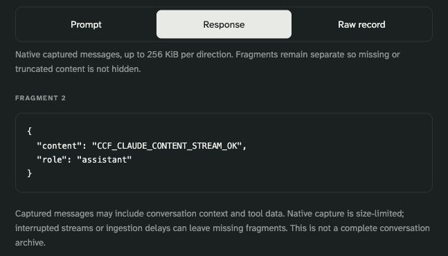

# Prompt and response logs

The optional **Prompt & response logs** workspace lets portal **owners and administrators** inspect captured Claude and Codex inference messages. Billing, auditor and developer roles cannot list or open this content. These are admin-console roles, separate from Azure subscription roles.

Capture is **off by default**. Existing metadata logs cannot reconstruct earlier prompts or replies. This feature captures requests passing through the selected APIM APIs after enablement; it does not read local chat databases, import ChatGPT history, or provide a full conversation archive.

## What administrators see

1. Open **Prompt & response logs** in the portal.
2. Select a local-time range, an API, a developer object ID, a model deployment, or a request correlation ID. Search results contain metadata only, with separate indicators for captured input and output.
3. Select **Inspect** to open a drawer. Enter a support or audit reason, without secrets, and select **Record access & open content**.
4. Switch between **Prompt**, **Response**, and **Raw record**. Native fragments and sequence numbers are preserved; the portal does not silently join, summarize or rewrite the capture.



*Hosted preview, 2026-10-15. Synthetic verification content only; the crop excludes pointers and operator identifiers. This is a captured inference response, not a full conversation export.*

Every content-open attempt is saved to the administrative audit trail before the content query runs. If auditing fails, content is not returned. Permissions are checked again after the query. Raw text is rendered as escaped text, never executable HTML, and is not added to browser storage, the portal state Blob, audit event bodies, or the aggregate usage cache. Closing the drawer removes it from the displayed page. Authorized people can still copy or screenshot it.

Azure ingestion is delayed. Interrupted streams, configured size limits and missing fragments can leave incomplete records. The default capture limit is **256 KiB per direction**. A “Prompt” or “Response” indicator means content exists, not that an entire turn or conversation was captured. Inputs can include system instructions, earlier messages, source code, tool data, and secrets placed in a prompt. There is no claim of automatic PII or secret redaction inside message text.

## Enable for an organization

Use the existing **standard Azure API Management** service; no new AI Gateway resource or proxy is required. The optional template creates a dedicated Log Analytics workspace for content and gateway correlation records. It leaves the existing Application Insights body/header capture settings alone.

Before enabling, communicate the capture policy to developers and choose the APIs, administrators, retention and logging cost limits appropriate for the organization. The platform administrator needs APIM diagnostic-write, Log Analytics resource/table-write, and role-assignment permissions. The portal runtime only receives Log Analytics Reader on the dedicated workspace; it cannot enable capture or change retention.

1. Obtain the existing portal managed identity's **object ID** from its deployment output, `identityObjectId`.
2. Save the following as a private parameter file and replace all placeholders. Use only the API IDs that should capture content; `claude-foundry-preview` and `codex-foundry` are examples.

```json
{
  "parameters": {
    "apimName": { "value": "ccf-apim-<suffix>" },
    "workspaceName": { "value": "ccf-content-logs-<suffix>" },
    "location": { "value": "eastus2" },
    "apiIds": { "value": ["claude-foundry-preview", "codex-foundry"] },
    "portalIdentityObjectId": { "value": "<portal-managed-identity-object-id>" },
    "captureEnabled": { "value": true },
    "retentionDays": { "value": 7 },
    "messageBytes": { "value": 262144 }
  }
}
```

3. Deploy into the existing APIM resource group:

```bash
az deployment group create --subscription '<subscription>' \
  --resource-group '<apim-resource-group>' --name ccf-content-logs \
  --template-file infra/content-logs.bicep \
  --parameters @.local/content-logs.parameters.json \
  --query properties.outputs.portalContentLogsConfig.value \
  --output json > .local/content-logs-config.json
```

4. Set the portal application's `PORTAL_CONTENT_LOGS_JSON` app setting to the JSON object in that output, or supply it as `contentLogsConfig` when deploying `infra/portal.bicep`. Preserve the existing portal app settings and infrastructure parameter values. Restart/redeploy the app to load the configuration.
5. Deploy the updated portal package. Generate synthetic, non-sensitive Claude and Codex requests in both JSON and streaming modes. Confirm both prompt and response capture through the portal, authorization denials for other roles, and the content-access audit entry. A successful ARM deployment alone is not a capture test.

The template configures native LLM message logging only on the listed APIs. Conventional HTTP body capture is zero and credential headers are not selected. Its separate service diagnostic destination exports gateway correlation records as well; it may receive metadata for other APIs on that APIM service. The portal always filters by the configured resource ID and API allowlist before returning records. Use a dedicated APIM instance if sharing even operational metadata is inappropriate.

## Retention, permissions and cost

Both content tables use seven-day analytics and total retention by default, with no intentional long-term archive. The portal also enforces its configured retention window on every query, including direct request-ID reads. Azure controls physical deletion; shortening an existing retention period has a deletion grace period, so a shorter query window is not proof of immediate erasure. The template allows 4–30 days. [Azure Monitor retention behavior](https://learn.microsoft.com/en-us/azure/azure-monitor/logs/data-retention-configure).

The workspace requires workspace permissions instead of accepting APIM resource-only permissions. Its Azure administrators and Log Analytics readers can query the underlying data outside the portal, bypassing portal roles and portal access auditing. Review those assignments, restrict network access where needed, and manage any separate Azure export rules. The workspace query endpoint is public HTTPS with Entra authentication; it is not a private endpoint deployment.

The audit trail shares the portal's existing mutable, versioned state Blob. It is not an immutable compliance archive. Content-open events increase that state's size and revision. Read attempts wait while policy publication is in progress; another administrator's concurrent update can require a reload. Retention of the audit trail is independent of the captured messages.

Log ingestion is billable and increases with prompt/context size. Shortening Analytics retention below the included period does not reduce ingestion charges. Model and infrastructure charges remain separate. Observe actual volume before customer rollout. [Native APIM message logging](https://learn.microsoft.com/en-us/azure/api-management/api-management-howto-llm-logs).

## Pause and recover

Redeploy the **same complete API list** with `captureEnabled=false`, then update the portal setting with the new deployment output. Already captured records remain available until retention expires. Removing an API from the template's list is not a reliable disable operation: an incremental deployment leaves the old diagnostic resource in place. Explicitly disable it before removing it from the list.

To hide the feature entirely, clear `PORTAL_CONTENT_LOGS_JSON`. This only disables portal access; it does not stop APIM capture. To stop collection, disable the selected API diagnostics first. Do not delete the workspace as a routine disable action.

See [security boundaries](security.md), [identity and permissions](identity-and-permissions.md), and the [validation record](../portal/VALIDATION.md).
