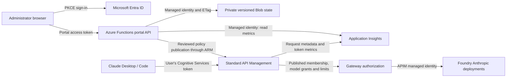

# Identity, permissions, and request flow

For Codex Desktop/CLI, see [Codex identity and routing](codex.md#identity-security-and-logging). The feature preview uses the baseline user-token/RBAC path through a separate `codex-foundry` API; portal roles and grants currently apply to Claude only. Users may choose the same Azure CLI or lightweight MSAL sign-in mechanism.

[← README](../README.md) · [Security boundaries](security.md) · [Portal guide](portal-guide.md) · [Validation evidence](../portal/VALIDATION.md)

Claude & Codex on Azure separates three kinds of authority: permission to use a model, permission to administer the portal, and permission to administer Azure. A portal role does not grant an Azure role or an Entra directory role.

## How the pieces work together

This diagram describes **portal governance**. The baseline gateway forwards the user's delegated token to Foundry instead; its users need inference RBAC themselves. Do not confuse those authorization modes when reviewing direct Foundry access.

The portal is outside the inference path. An unavailable portal stops administration and publication, but the last published APIM policy continues serving requests.

## Portal sign-in and server authorization

1. The SPA loads public bootstrap metadata: tenant ID, portal client ID, and sign-in configuration. These identifiers are not secrets. HTML, assets, bootstrap, and health are public; organization state is authenticated.
2. MSAL performs authorization-code sign-in with PKCE against the organization's tenant. It requests the portal's delegated `api://<portal-client-id>/access_as_user` scope. There is no browser client secret. The current implementation uses browser session storage for MSAL's cache.
3. The API validates the JWT signature against that tenant's fixed signing-key endpoint, RS256 algorithm, v2 issuer, audience, tenant, expiration, not-before and issued-at claims. It also requires `access_as_user`, the expected client (`azp`), and a valid user object ID (`oid`). A Cognitive Services token is not a portal access token.
4. The server looks up that object ID in private portal state and requires an active member. Email, display name, browser-provided roles, and forwarded identity headers cannot grant access. A guest uses its object ID **in the resource tenant**.
5. Every API request checks membership again. Authorization and mutations use the same state snapshot; writes require its Blob ETag and the client's reviewed revision. Concurrent changes fail with 409 rather than overwrite another administrator's work.

These checks follow Microsoft's guidance to validate the token's [audience, tenant, subject, and authorized client](https://learn.microsoft.com/en-us/entra/identity-platform/claims-validation). Conditional Access, MFA, consent, and account disablement remain Entra responsibilities. The app does not configure those tenant policies or claim immediate revocation of an already issued Entra token. Portal suspension blocks subsequent portal requests; requests already in progress may finish.

Use a dedicated single-tenant registration per environment. Register exact HTTPS redirect URIs. Localhost redirect URIs are for development registrations and should be removed from a customer production registration. The development `PORTAL_LOCAL_MODE=1` bypass requires loopback, is rejected in Azure, and must never be exposed through a tunnel or reverse proxy.

## Portal role matrix

| Capability | Owner | Administrator | Billing | Auditor | Developer |
| --- | --- | --- | --- | --- | --- |
| View organization members, groups, audit and analytics | Yes | Yes | Yes | Yes | Own member/group and requests only |
| Export own client profile; request model access | Yes | Yes | Yes | Yes | Yes |
| Add/import/edit members and model grants | Yes | Yes, except owners | No | No | No |
| Inspect captured prompts/responses with an audited reason | Yes | Yes | No | No | No |
| Change ownership | Yes | No | No | No | No |
| Edit groups, token quotas and request rates | Yes | Yes | No | No | No |
| Set organization dollar planning threshold and model rates | Yes | Yes | Yes | No | No |
| Approve/decline access requests | Yes | Yes | No | No | No |
| Review and publish gateway policy | Yes | Yes | No | No | No |
| Export another group's client profile | Yes | Yes | No | No | No |

Owners cannot suspend themselves or change their own role. At least one active owner must remain. CSV imports create active developers only; they cannot overwrite existing object IDs or elevate roles. Registration does not send an invitation or create an Entra account. A member has one primary group plus optional personal model grants. Groups are portal records, not synchronized Entra groups.

Billing and auditors can read organization identities and administrative history, not just totals. Assign those roles accordingly. Developers cannot query organization telemetry or cost analysis. The developer state response includes the available model catalog so they can request access; only their effective grants are exported in their client profile.

## Azure runtime identities and exact scope

| Identity | Permission | Scope and purpose |
| --- | --- | --- |
| Portal user-assigned managed identity | Custom Claude & Codex policy editor | One configured APIM API. Allows API-policy and operation-policy read/write. The code updates the API policy and `models` operation; the role can edit **all operation policies within that API**. |
| Portal managed identity | Monitoring Reader | Selected Application Insights component, for usage and cost queries. This can read the component's other telemetry too; API filtering in application queries does not narrow Azure RBAC. Use a dedicated component when stronger isolation is required. |
| Portal managed identity (optional content logging) | Log Analytics Reader | Dedicated content-log workspace. Reads its underlying tables; API allowlisting is enforced by portal code, not this Azure role. Workspace/Azure administrators can bypass portal view auditing. |
| Portal managed identity | Monitoring Metrics Publisher | Same Insights component, for authenticated portal telemetry ingestion. |
| Portal managed identity | Storage Blob Data Owner | Dedicated portal storage account, containing Functions host/deployment data and portal state. This includes write/delete authority over those blobs. |
| APIM managed identity | Cognitive Services User | Configured Foundry account, for governed inference. Confirm the actual foundation/preview assignments before deployment. |
| Workstation user | Entra delegated Cognitive Services token | The published gateway policy checks the caller's tenant/object ID and entitlements. In governance mode, Foundry receives APIM's identity. |

The host storage role follows the documented [identity-based `AzureWebJobsStorage` requirements](https://learn.microsoft.com/en-us/azure/azure-functions/manage-connections). It is deliberately account-scoped because the same dedicated account supports the Functions host and deployment containers. Separating application state into another storage account and identity is an additional isolation option, not the current template.

The portal has no Graph directory permission, Azure billing role, subscription-wide Contributor role, or permission to read APIM subscription keys. The public portal registration requests only its own delegated API scope. Runtime identities must not inherit broader assignments from a subscription or management group; review inherited assignments as part of customer deployment.

## Who needs setup permissions

Infrastructure deployment needs Azure resource creation/update permissions in the target resource groups, plus permission to create the custom role definition and role assignments at their scopes. A resource Contributor alone cannot assign RBAC. An approved combination such as Contributor plus Role Based Access Control Administrator may be used, subject to customer conditions and custom-role privileges.

Entra registration/consent is a separate operation. The setup operator must be allowed to create or manage the dedicated application and service principal, and an appropriate identity administrator must grant consent when tenant policy requires it. The setup script uses the operator's delegated Graph token; it does not give Graph authority to the hosted portal. Marketplace attestation and model eligibility are subscription responsibilities.

After deployment, ordinary portal members and workstation users do not need Azure CLI or resource-creation privileges. The recommended workstation MSAL mode uses a separate desktop public-client registration and macOS Keychain-backed token storage. Azure CLI authentication remains an alternative. Keep installer/profile distribution under organizational control because the profile specifies the gateway that receives the user token.

## Saving, publication, and revocation

Saving writes a draft and an audit event. Portal roles and suspension affect subsequent portal requests immediately. Model grants, group membership, token quotas and request rates affect inference only after an owner/administrator reviews the current revision, confirms the organization name, and publishes.

Publication first saves a `publishing` marker with an ETag. Edits and competing publications are blocked. The portal then reads the existing API/catalog policies and writes the compiled pair through Azure Resource Manager. A failed or uncertain write triggers restoration attempts for every attempted policy, including a timed-out write. Both restores are attempted even if one fails. This is **not an atomic transaction across Azure resources**; rollback, process termination, or the final state save can still fail. Follow the [recovery runbook](operations.md#portal-publication-recovery) before retrying an uncertain publication.

The client profile reflects saved draft entitlements; it does not publish them. Distribute it after successful publication and a gateway check. Downloading a profile does not install Claude or grant access by itself. Catalog updates require redistributing profiles.

For offboarding, suspend the member and publish, then verify a denied gateway request. Separately revoke any direct Foundry RBAC and directory access as appropriate. An identity with direct inference permission can bypass the gateway while Foundry's public endpoint remains reachable. APIM regional token/rate counters are operational controls, not globally atomic billing caps; [streaming token estimation and quota accuracy have limits](https://learn.microsoft.com/en-us/azure/api-management/llm-token-limit-policy).
