# Management portal guide

> **Budget hierarchy branch:** the additional `group_admin` role, owner-controlled USD ceilings, shared ledger and request-time team content scope are documented in [Enforced USD limits](budget-enforcement.md). These require the dedicated budget runtime and remain subject to its release checks. The legacy token/planning controls below still describe the existing gateway.

[← README](../README.md) · [Deploy the Azure preview](../portal/README.md#isolated-azure-preview) · [Operations](operations.md)

The portal gives your organization one place to manage developer access through its Claude gateway and understand usage. It runs in your Azure subscription and uses your Microsoft Entra tenant. It is currently a **preview**; review the [validation record](../portal/VALIDATION.md) before a production rollout.

This walkthrough uses screenshots captured from the real Azure-hosted application in Edge on **October 14, 2026**. They show the isolated preview's actual state and small verification workload, including deliberate denial tests. Captures omit operator identities and infrastructure identifiers. No fictional customers or usage have been added. Your models, roles, traffic, and prices will differ.

## Start with your role

Open the portal URL supplied by your platform team in your normal work browser. Choose **Continue with Microsoft** and use the account authorized by your organization. Existing browser sign-in can be reused; tenant MFA and Conditional Access still apply.

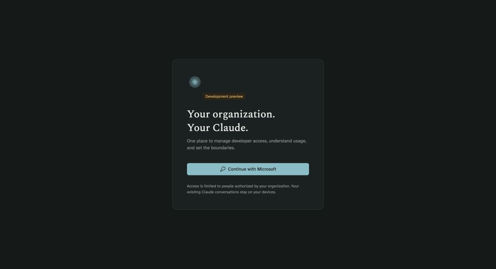

An **owner or administrator** manages people, groups, and gateway policy. **Billing** maintains organization planning budgets and model rates. **Auditors** inspect administrative data. **Developers** download their setup profile and request model access; they do not receive the full administrative view shown below.

## Overview

Start here to see gateway activity, active developers, failed requests, policy status, and items requiring review. Open analytics for request details or review a draft before publishing it. The recent-changes panel links to audit events.

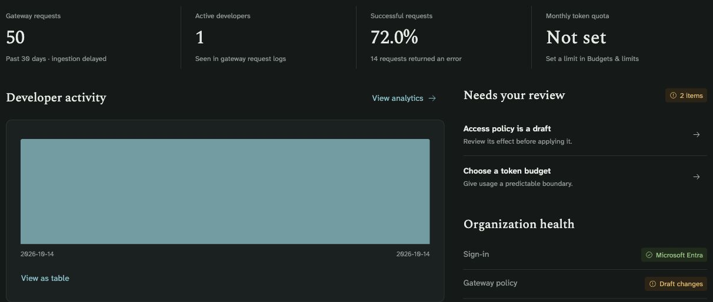

*The screenshot shows a real test day. Its error count includes intentional authentication and authorization tests; it is not an availability benchmark.*

## Members and bulk onboarding

Open **Members → Add member**. Enter the person's Entra object ID from your tenant, name, email, role, and primary group. For a guest, use the guest object's ID in your tenant. Choose a monthly personal token limit or leave `0` for no personal limit. Group and organization controls still apply.

Personal model grants add exceptions to the primary group's models. Save the member draft, then review and publish it to change gateway access. Registration does not create an Entra account or send an invitation.


The members workspace also provides search/filtering, export, editing, and suspension. Suspending a member blocks portal access from current state; gateway access changes after publication. It does not erase local Claude conversations.

<details>
<summary>Import a team from CSV</summary>

Choose **Import CSV**, select the default portal group, and use the supplied template. Required columns are `object_id,name,email`; `group_id` is optional. Validate and review before saving. A file can contain up to 2,500 new developers. Existing members are not overwritten, duplicate IDs are rejected, and imports cannot assign elevated roles.

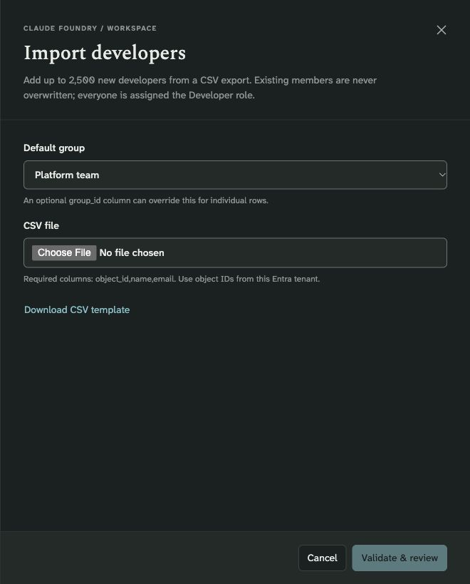

</details>

## Groups

Use groups to give a team a common model selection, default model, monthly token quota, and planning budget. Each developer has one primary portal group; these groups do not synchronize with Entra groups. A group's default model must be one of its allowed models.

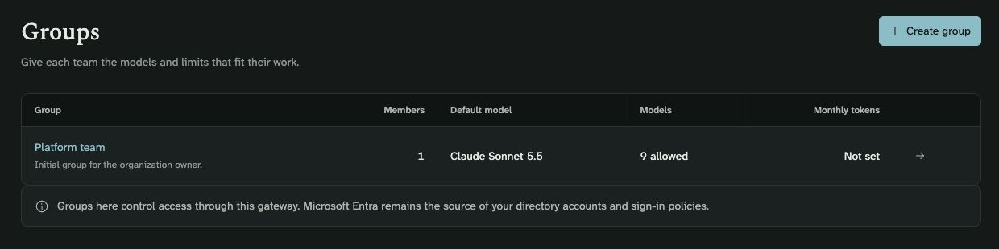

Open a group to edit its grants in a drawer. Save, then publish to apply gateway controls. A dollar planning budget remains an estimate threshold rather than a billing cap.

## Roles and permissions

Portal roles govern administrative actions; model grants govern inference access. Assign the smallest role the person needs. Only an owner can change ownership. The application prevents self-suspension/self-role changes and removal of the last active owner.

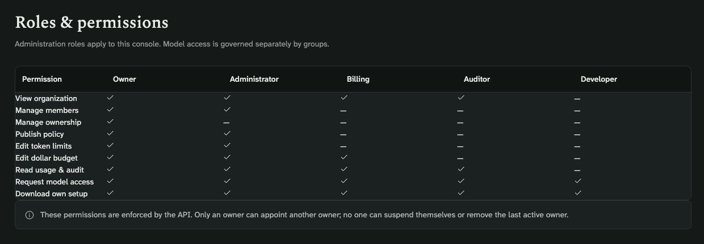

These roles do not grant Azure subscription administration or Entra directory privileges.

## Model access and publication

**Model access** lists the configured deployments and which groups can use them. Deployment and quota management still happen through the administrator CLI/Azure. The portal publishes access to the configured catalog; it does not purchase or deploy new models.

<details>
<summary>View the deployed model catalog</summary>

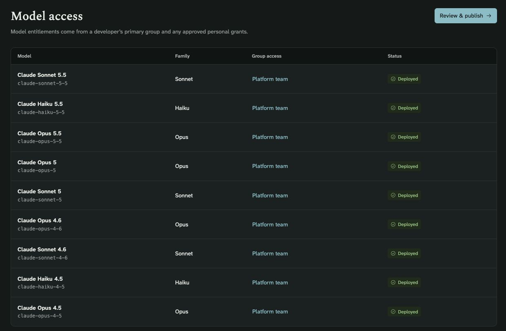

</details>

The everyday workflow is **edit → save draft → review → publish → verify**:

1. Save member, group, and token-limit changes.
2. Choose **Review & publish** and inspect affected membership and the target gateway.
3. Confirm the organization name and publish the reviewed revision.
4. Verify a new allowed request and a new denied request on the preview API. Azure policy propagation may take time.

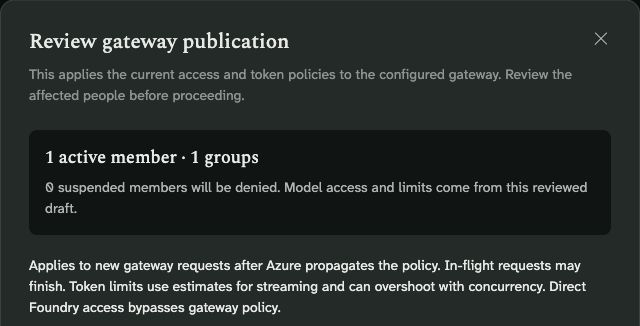

*The capture shows the impact section. The gateway address and confirmation controls below it are omitted to keep deployment identifiers private. No policy was published while taking these screenshots.*

Published policy uses the gateway's managed identity to call Foundry. Review developers' direct Foundry RBAC, which can bypass gateway governance. In-flight requests may finish. If publication fails, the draft is retained; investigate the actual policy and visible error before retrying.

## Model access requests

A developer can choose **Request model access**, select a deployed model, and explain the need. Owners/administrators review and approve or decline the request. Approval creates a personal model grant; it takes effect at the gateway after publication.

<details>
<summary>See the request workspace and form</summary>

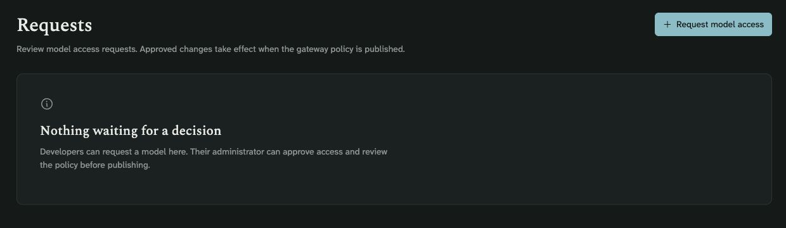

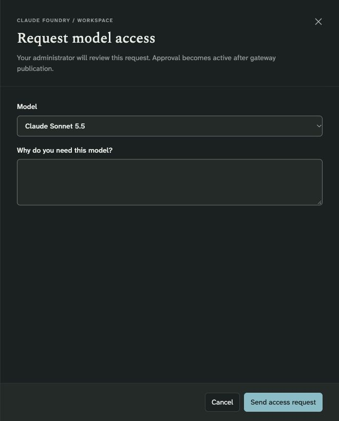

</details>

## Usage and analytics

Choose **Usage & analytics** for request counts, distinct callers, errors, duration, model summaries, and recent gateway requests. Select 7, 30, or 90 days, refresh, or export the view. The daily chart also has a table view.

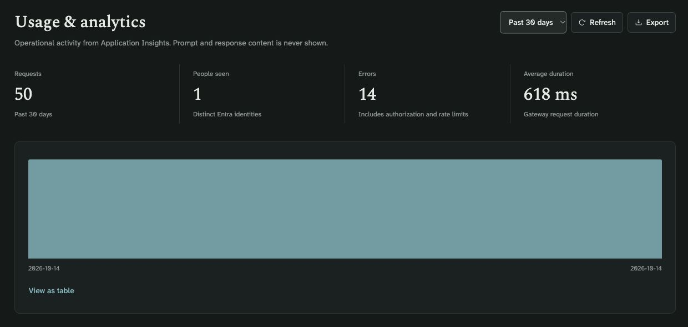

This page shows operational metadata, not prompts or responses. Application Insights ingestion is delayed; recent request details are limited to 250 entries. Counts honor telemetry sampling weights. [Observability](observability.md) explains the underlying logs and token metrics.

## Cost analysis

Use **Cost analysis** to answer questions such as “Which model is driving token growth?” or “How has this team's estimated spend changed from the previous period?”


1. Choose **This month**, **7 days**, **30 days**, or **90 days**; open the date control or **Filters** for a custom UTC range, up to 93 days.
2. Combine model, group, and developer filters. Selections within one dimension are alternatives; separate dimensions narrow one another. Use the chips to remove individual filters.
3. Switch the trend between tokens and estimated USD. Enable **Compare** for the immediately preceding period of equal length, or open the daily table for exact values.
4. Group the breakdown by **Models**, **Groups**, or **Developers**. Search, sort, page through results, or select a row to drill down. Filters are reflected in the URL and browser history.
5. Export the selected analysis as CSV. Review attribution quality and any truncation notice alongside totals.

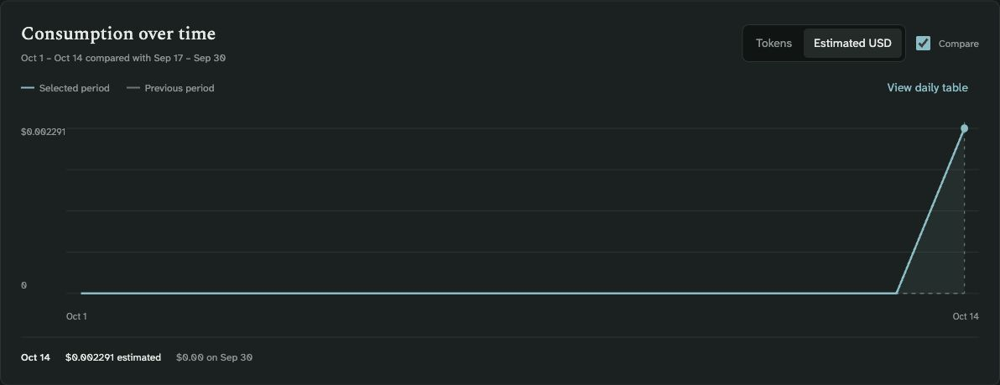

<details>
<summary>Explore the filter drawer</summary>

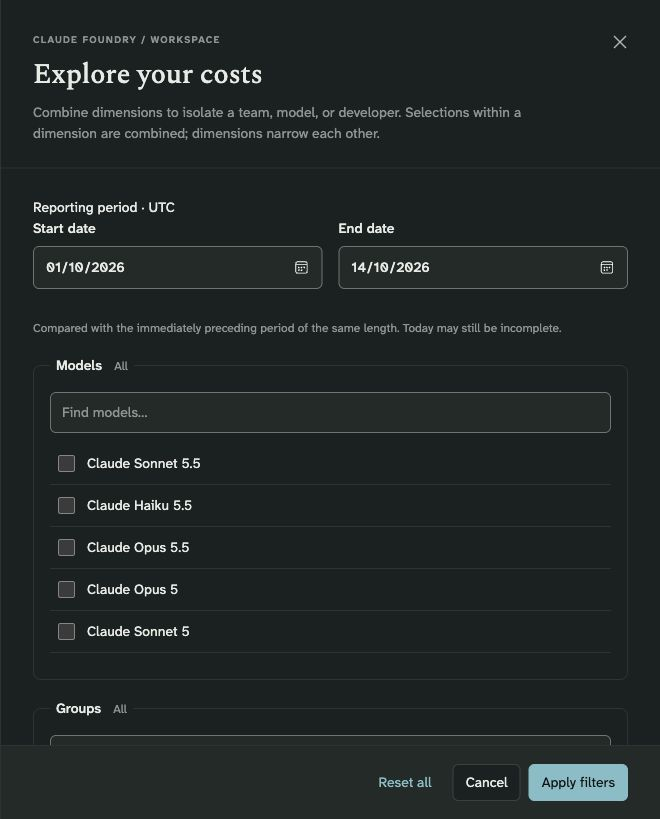

The drawer also contains group and developer selectors below the visible model list. Individual developer identities are excluded from this capture.

</details>

**Interpret the figures carefully.** Totals are aggregated in Application Insights; detailed breakdowns are capped at 2,500 dimensions across both periods and explicitly marked when truncated. Queries are cached for 60 seconds. Missing historical group/developer dimensions appear as unattributed; they are not assigned retroactively. Today's period can be incomplete.

Costs use the current input/output planning rates. Cache charges, some prompt-length tiers, discounts, tax, and infrastructure costs are not reconciled. Changing rates recalculates historical estimates. Rate coverage indicates that reported tokens have configured rates, not that all Azure charges are included.

## Budgets, token limits, and rates

In **Budgets & limits**, distinguish the dollar planning threshold from gateway-enforced token/rate controls. `0` means no limit at that scope. Organization and group controls can still restrict a developer whose personal limit is zero.

<details>
<summary>Edit organization budgets and limits</summary>

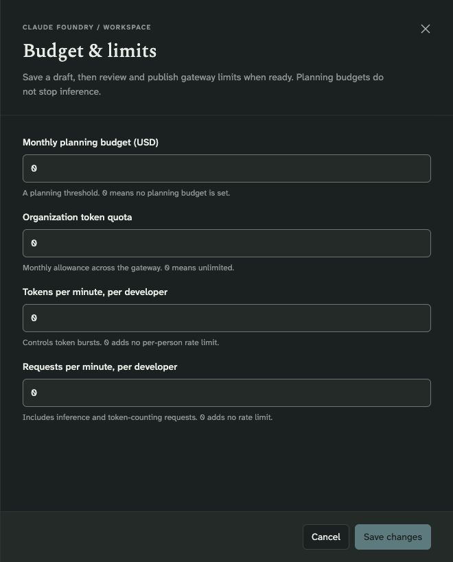

</details>

Publish token/rate changes before expecting gateway enforcement. Streaming token estimates and concurrency can overshoot; separate gateway regions do not share an atomic global counter. Dollar thresholds do not stop inference or Azure billing.

Use **Set rates** or **Manage rates** to maintain input/output prices in USD per million tokens. The cost-analysis rate editor also records source, verification date, and notes. Choose prices appropriate to the actual deployment type, geography, and contract; the [dated pricing reference](../portal/PRICING.md) is a starting point, not automatic synchronization with Azure.

<details>
<summary>See the planning-rate editor</summary>

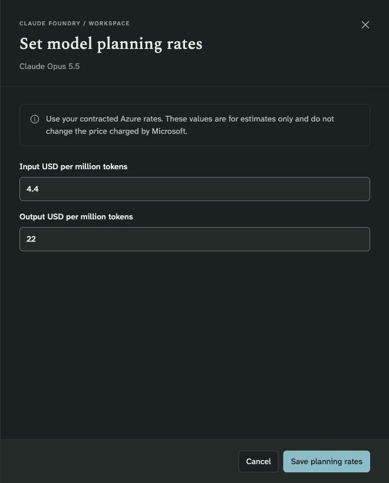

This capture shows the budget workspace's rate editor. The example price applies to the preview's deployed SKU and must not be copied to a different deployment without review.

</details>

## Audit log

Use **Audit log** to search administrative changes, inspect event details, or export the current view. Events record the actor, timestamp, action, target, and before/after values, including drafts and publication activity.

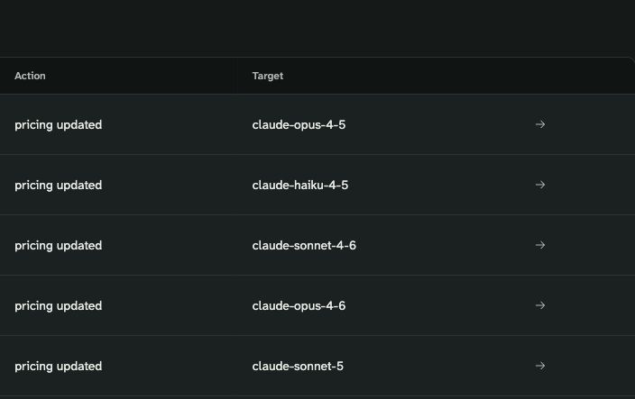

*Actor and timestamp columns are outside this crop. Events are real saved price changes.*

Displayed times use the browser's timezone; JSON details retain UTC. State and audit events share a versioned Azure Blob. This is a change history with recovery support, not an immutable compliance archive.

## Developer onboarding

After granting and publishing access, export the group-specific client profile from **Developer onboarding**. Developers can download their own profile. A profile contains connection settings and model choices, not credentials; each person signs in separately.

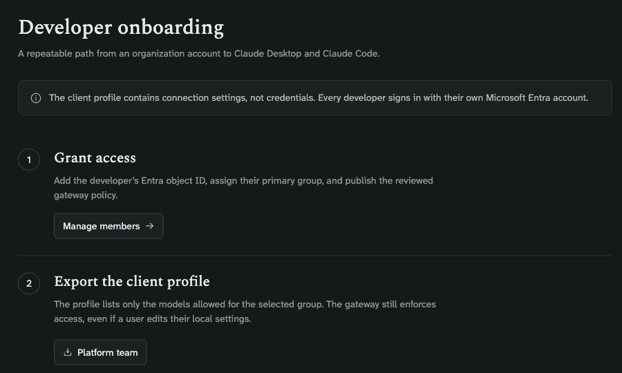

The administrator packages that profile using the repository's bundle builder and distributes the ZIP through an approved internal channel:

```bash
uv run python scripts/build_client_bundle.py \
  --profile /path/to/client.json \
  --output dist/claude-foundry-macos.zip
```

Users follow the [Mac installation guide](macos.md). For MSAL without Azure CLI, the portal deployment must be configured with the separate desktop public-client ID. The portal does not push device policies or track installation completion; use your MDM platform for managed rollout.

## Organization settings and navigation

**Organization** shows the portal display name, connected sign-in provider, gateway, and captured-data scope. Owners/administrators can change the display name in a drawer. Infrastructure endpoints and tenant connections are deployment configuration, not editable here.

<details>
<summary>See the organization editor</summary>

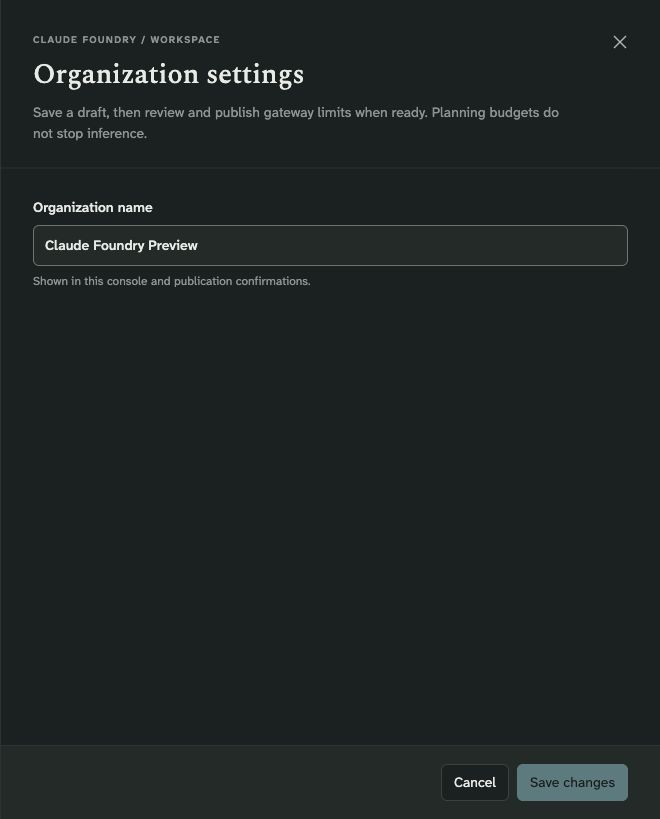

</details>

Use **Search or jump to…** (`⌘K` on Mac) to find pages and people. The theme control supports system, light, and dark appearance. Forms use drawers with fixed actions; unsaved edits require a discard decision when closing. Conversation retention, device compliance, and invoices remain in their respective systems.

## When something goes wrong

For an expired session, sign in through your normal work browser. For a sign-in error, retain the correlation ID and timestamp for your identity administrator; repeatedly approving MFA is not a fix for a blocked authentication method. For missing usage, check the selected period, filters, ingestion delay, and monitoring permissions. For conflicting edits, refresh and review the latest revision before retrying.

See [troubleshooting](troubleshooting.md), [operations](operations.md), and the [portal engineering guide](../portal/README.md) for diagnostics, recovery, and deployment details.

## Prompt and response logs

Owners and administrators can use **Prompt & response logs** when the platform team has enabled capture. Filter by date/time, API, developer object ID, model, or request ID, then inspect a record in a drawer. An access reason is audited before its captured prompt and response are displayed. Billing, auditors, and developers cannot open this workspace. Capture is off by default and cannot recover earlier chats. See [setup, retention and permission boundaries](content-logs.md).
