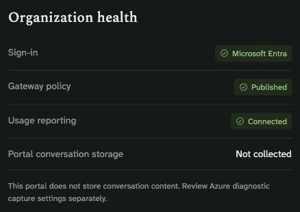

# Security architecture

[← README](../README.md) · [Identity and permission reference](identity-and-permissions.md) · [Report a vulnerability](../SECURITY.md) · [Operations](operations.md)

Claude & Codex on Azure has two gateway authorization modes. Choose deliberately: switching from the baseline user-token path to portal governance changes which identity Foundry authorizes. The portal deployment workflow prepares a separate preview API so this can be evaluated without replacing the baseline API.

Actual hosted preview, 2026-10-14. This status panel reports portal behavior; it does not audit separate Azure diagnostic settings or certify deployment security.

## Inference authorization

| Boundary | Baseline gateway | Portal governance preview |
| --- | --- | --- |
| User identity | Delegated Entra access token for `https://cognitiveservices.azure.com` | Same user-token audience |
| APIM validation | Signature, issuer, tenant, audience, expiry; optional caller object-ID allowlist | Token validation plus published active membership, model entitlements, and token/rate controls |
| Backend identity | Original user's bearer token | APIM's managed identity |
| Foundry authorization | User/group inference RBAC | APIM managed-identity inference RBAC |
| Model catalog | Organization-wide published allowlist | Catalog filtered by published member entitlements |

The foundation disables Foundry local/API-key authentication. APIM's `subscriptionRequired: false` removes the subscription-key gate after JWT validation is installed; it does not make inference anonymous. Incoming API-key headers are stripped before forwarding. Optional baseline `allowed_object_ids` contains user/service-principal object IDs, not group IDs.

The public Foundry endpoint remains directly reachable by identities with valid inference RBAC. Direct access bypasses APIM restrictions and telemetry in either mode. Portal membership alone cannot remove separately granted Azure permissions. Review direct RBAC and network design before relying on gateway-only governance; the baseline foundation is not a private inference network.

## User workstation

MSAL uses a tenant-owned public client, browser PKCE, and encrypted persistence backed by macOS Keychain. There is no client secret or plaintext token-cache fallback. Azure CLI mode uses the CLI's own credentials; background refresh targets the tenant without changing the default subscription. Interactive CLI login may change normal CLI account state.

Background credential helpers never launch interactive sign-in. Users explicitly run `login` when interaction is needed. Browser-based MSAL does not implement device-broker authentication; validate device-bound-token and broker requirements with the customer identity team.

The client profile controls the HTTPS destination receiving the user's token. Distribute it and the installer through a trusted organization channel. Files use private permissions. Recovery snapshots can contain credentials that predated installation; protect them like the original settings. The installer is a source/script distribution, not a signed or notarized application package.

Optional [conversation import](conversation-migration.md) enables Claude's native importer. Source Claude.ai authorization/export is separate from Entra inference authorization. Review the source-organization policy and allowed network egress before rollout; Entra tenant restrictions do not restrict the Claude.ai source account. Imported content stays in Desktop's local store and can be sent through APIM/Foundry when resumed. The portal and installer never receive the archives. Protect exports and local history with endpoint controls and disk encryption. Installation rollback does not erase copied history. This integration disables automatic background copying and session export when applying an import policy, preserves existing source restrictions unless explicitly replaced, and refuses to override MDM import settings or redirect custom import endpoints.

## Portal identity and permissions

The hosted portal uses a separate, single-tenant Entra SPA/API registration with authorization-code flow and PKCE. The server validates access tokens and active-member state; browser-displayed roles are not an authorization boundary. The desktop public-client registration is distinct from the portal registration.

Owner and administrator roles can publish reviewed access policies. Billing can update planning rates and the organization dollar threshold. Auditors have administrative read access; developers receive their own setup/request views. Only owners can change ownership; the domain rules preserve at least one active owner. [See the role matrix](portal-guide.md#roles-and-permissions).

Saving member suspension immediately affects portal access; gateway access changes after the reviewed policy is published and propagated. In-flight requests may finish. Monthly token quotas use gateway-region counters; streaming estimation and concurrency can overshoot. Dollar budgets are not billing caps.

`PORTAL_LOCAL_MODE=1` is an explicit local owner bypass for development. It is restricted to loopback and rejected in Azure hosting. Never expose it through a proxy/tunnel or use it as authentication-test evidence.

## Azure identities, storage, and network

The portal template uses managed identity with access to policies for one configured APIM API (including its operation policies), the selected Insights component, and the dedicated portal storage account. It does not grant directory management or Azure invoice access. The portal is outside the inference path. The [permission reference](identity-and-permissions.md#azure-runtime-identities-and-exact-scope) distinguishes the code's operations from the broader authority of each Azure role.

Blob state uses managed-identity access, shared keys disabled, versioning, 30-day soft deletion, and ETag conflict checks. Private networking is enabled by default. The optional public-storage-endpoint configuration is a different network posture and must meet organization policy. A private Blob endpoint does not make the public portal, APIM, or Foundry endpoint private.

Administrative state and audit events share a mutable Blob. Authorized Azure storage administrators can change it; versioning is not an immutable compliance archive. Validate backup/restore and publication recovery before customer production use.

## Data and diagnostics

New gateway diagnostics record request metadata, model, request ID, and Entra principal object ID, with zero request/response body bytes. The portal stores member names/emails/object IDs, entitlements, limits, planning rates, access-request reasons, and administrative changes. Treat this as organizational data and restrict state/log readers accordingly.

Existing APIM diagnostics are preserved and may have different body/header capture settings. Review them explicitly, including service-level diagnostics. Do not log authorization headers or API keys. Token metrics are operational telemetry, not a billing ledger; interrupted streams may be incomplete.

The 2026-10-14 deployment audit found zero captured body bytes and no captured headers in the preview API and Application Insights service diagnostic, with query parameters hidden and credential headers masked. A separate, pre-existing service-level `azuremonitor` diagnostic has client-IP logging enabled. That diagnostic was preserved. Customer documentation and retention policies must account for client IPs when enabled.

The API caps received request bodies at 1 MB before JSON parsing, checks their declared length, validates structured input, rejects unknown fields, and returns no-store responses for API data. CSP, frame denial, no-referrer, nosniff and HSTS protect hosted responses, including normal authorization/validation rejections. React escapes rendered values; CSV exports neutralize spreadsheet formula prefixes. These controls do not provide a WAF, distributed portal API rate limiting, or protection against every denial-of-service scenario. Azure's HTTP host may buffer a request before application code sees it.

State and audit history currently share one growing JSON document. Monitor its size and latency, and plan an indexed store/archived audit design before relying on sustained enterprise-scale administration. There is no automatic immutable audit retention, SCIM provisioning, automatic Entra group synchronization, or billing reconciliation.

The portal does not read local conversation databases or control local history/retention. Its optional [content logs](content-logs.md) expose newly captured gateway messages to owners and administrators only. They use a dedicated workspace, seven-day configured retention, server-side API scopes, escaped rendering, no-store responses, and a durable access audit before a read. Content is not copied into portal state. Workspace readers can access it outside this audit boundary. Provider hosting, processing geography, and retention depend on model version/SKU and service terms. Review [Microsoft's Claude model documentation](https://learn.microsoft.com/en-us/azure/foundry/foundry-models/concepts/claude-models) for your deployments.

## Evidence and remaining review

The Codex feature preview has its own [identity and security boundary](codex.md#identity-security-and-logging) and [validation record](codex-validation.md). It uses user-token passthrough with Foundry inference RBAC, a dedicated model allowlist, stateless Responses, and API-scoped payload-free diagnostics by default. Optional content logging is a separate explicit deployment. It does not inherit the portal's membership, token quotas or budget publication. Direct Foundry access remains possible for users with inference RBAC. Visible-history exports are private local files that require review before a provider handoff; the exporter does not upload or modify the source conversation.

See [portal/VALIDATION.md](../portal/VALIDATION.md) for what was actually verified and what remains, including customer Conditional Access, hosted roles, recovery, and scale. This document describes the design and its boundaries; it is not a compliance certification or penetration-test report.
